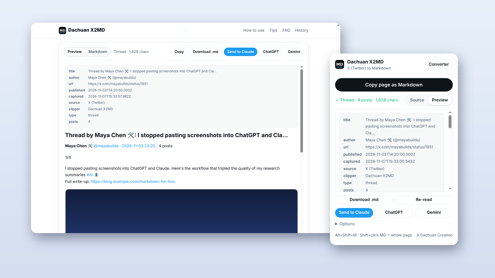

<div align="center">


# Dachuan X2MD

**Save any X (Twitter) post, thread or Article as clean Markdown, ready to paste into Claude, ChatGPT or Gemini.**

[](LICENSE)


English · [简体中文](README.zh-CN.md)



</div>

---

## Why

AI assistants **can't read X links**. X puts most content behind a login, so when you paste a URL into Claude or ChatGPT the model sees a login wall or an empty page. Screenshots lose the links, and copy-paste brings along reply counts, button labels and posts in the wrong order.

**Dachuan X2MD reads the page inside your own logged-in browser** and gives you one clean, ordered Markdown document.

## Features

- 🧵 **Whole threads, one document.** The extension auto-scrolls to load the full thread, merges the author's posts in order and labels them `1/N`, `2/N`, …
- 📰 **X Articles.** Headings, lists, quotes, code blocks and images become real Markdown.
- 🔗 **Nothing lost.** `t.co` links expand to real URLs, @mentions and #hashtags stay clickable, quoted posts become blockquotes, and images come out at original resolution.
- ⚡ **Fast to use, four ways:**
  - Toolbar popup: **Copy page as Markdown**
  - An **`MD` button** on every post (click to copy that post, Shift+click to copy the whole page)
  - Keyboard shortcut **Alt+Shift+M**
  - Right-click menu on any page or X link
- 🤖 **Send to AI.** One click opens Claude, ChatGPT or Gemini with the Markdown already typed into the chat box. You can add your own prompt, such as "summarize the key arguments".
- 🧰 **Built-in converter page.** Paste one or more links for a batch conversion, with a live preview, a `.md` download and history.
- 🔐 **Private.** No servers, no analytics, no account. Everything runs in your browser.
- 🌏 **English and 简体中文.** The interface follows your browser language.

## Example output

```markdown
---
title: "Thread by Maya Chen 🛠️: I stopped pasting screenshots into ChatGPT and Cla…"
author: "Maya Chen 🛠️ (@mayabuilds)"
url: "https://x.com/mayabuilds/status/1851"
published: "2026-11-03T14:20:00.000Z"
source: "X (Twitter)"
clipper: "Dachuan X2MD"
type: "thread"
posts: "4"
---

# Thread by Maya Chen 🛠️: I stopped pasting screenshots into ChatGPT and Cla…

**Maya Chen 🛠️** [@mayabuilds](https://x.com/mayabuilds) · [2026-11-03 23:20](https://x.com/mayabuilds/status/1851) · 4 posts

### 1/4

I stopped pasting screenshots into ChatGPT and Claude. Here's the workflow that tripled the quality of my research summaries [#AI](https://x.com/hashtag/AI) 🧵
Full write-up: https://blog.example.com/markdown-for-llms


### 2/4 · [2026-11-03 23:21](https://x.com/mayabuilds/status/1852)

1/ Screenshots lose links, order and context. Copy-paste drags in reply counts and button labels. Models hate both.

> **Quoting Alex Rivera [@arivera](https://x.com/arivera)** · [2026-10-30 18:00](https://x.com/arivera)
>
> Hot take: most "the AI got it wrong" moments are really "I gave it messy input" moments.
```

*(Demo content, shortened.)*

## Install

> A Chrome Web Store listing is planned. Until then, installing takes about 30 seconds:

1. Download the latest **`dachuan-x2md-vX.Y.Z.zip`** from [Releases](../../releases) and unzip it. You can also `git clone` this repo.
2. Open `chrome://extensions` and turn on **Developer mode** (top right).
3. Click **Load unpacked** and select the unzipped folder.
4. Pin the extension (puzzle icon → 📌), open any post on x.com, and click the icon.

It works in Chrome, Edge, Brave, Arc and other Chromium browsers.

## Usage

| What you want | How |
|---|---|
| Copy a whole thread or article | Open it, then click the toolbar icon → **Copy page as Markdown** |
| Copy one post | Click the **MD** button in the post's action bar |
| Copy the whole page from any post | **Shift + click** the MD button, or press **Alt+Shift+M** |
| Convert a link without opening it | Popup → **Converter**, then paste one or more links |
| Ask an AI about it | **Send to Claude / ChatGPT / Gemini** |

**Options:** YAML front matter · images / video covers · linked @mentions and #hashtags · engagement stats · include replies · auto-scroll.

## How it works

- **In the page.** A content script parses X's DOM (`article[data-testid="tweet"]`, `tweetText`, `User-Name`, `time`, and so on) into structured posts, then renders Markdown. For long threads it scrolls the page and collects posts until the author's run ends.
- **The converter page** opens the link in a background tab, using your login, extracts the content and closes the tab. If that fails, it falls back to public endpoints (FxTwitter, then X's embed/syndication API). These work without a login but only return single posts.
- **No dependencies, no build step.** It's plain JavaScript and Manifest V3. The core logic is in [`src/md.js`](src/md.js).

## Privacy

Dachuan X2MD does not collect, store or send any personal data. Conversion runs locally. The only network requests the extension makes on its own go to `api.fxtwitter.com` / `cdn.syndication.twimg.com`, and only when the converter falls back to public-API mode for a link you entered. See [PRIVACY.md](PRIVACY.md).

## FAQ

**Something didn't convert correctly.**
X changes its markup often. Please [open an issue](../../issues/new/choose) with the post URL (if it's public) and what you expected. Selectors live at the top of `src/md.js`.

**The thread is cut off when I use the converter page.**
Browsers throttle background tabs. Open the thread on X and use the toolbar icon instead. The foreground page auto-scrolls to load everything.

**Is this affiliated with X Corp?**
No. It's an independent open-source tool. "X" and "Twitter" are trademarks of X Corp.

## Roadmap

- [ ] Chrome Web Store / Edge Add-ons release
- [ ] Export to Obsidian / Notion
- [ ] Bookmarks and Lists bulk export
- [ ] Firefox support
- [ ] Custom Markdown templates

Have an idea? [Open an issue](../../issues). PRs are welcome.

## Contributing

1. Fork the repo and make your change. There's no build step: edit the files, then hit ↻ on `chrome://extensions`.
2. UI strings go in [`src/i18n.js`](src/i18n.js) (English + 简体中文).
3. Open a PR with a short description, and a screenshot if the UI changed.

## Support

If Dachuan X2MD saves you time, **please give it a ⭐**. It helps other people find it.

## License

[MIT](LICENSE) © Dachuan

<div align="center"><sub>A Dachuan Creation</sub></div>
