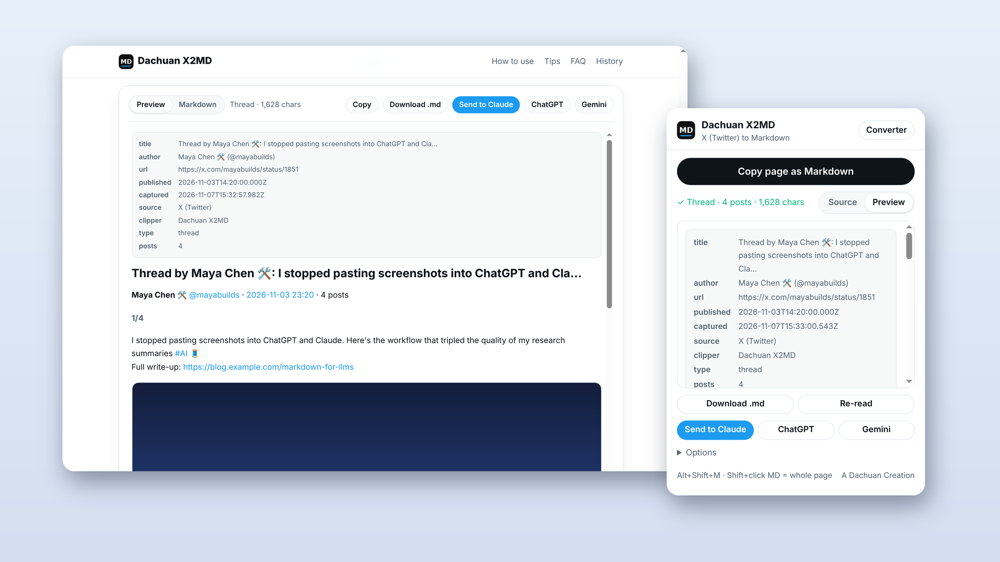

# Dachuan X2MD

**把 X（Twitter）帖子、串推、X Articles 一键存成干净的 Markdown，直接喂给 Claude / ChatGPT / Gemini。**

[English](README.md) · 简体中文

## 为什么需要它

AI **读不了 X 的链接**。X 的大部分内容都要登录才能看，你把链接丢给 Claude 或 ChatGPT，它拿到的只是登录墙或空白页。截图会丢链接；复制粘贴会混进回复数、按钮文字，顺序也容易乱。

**Dachuan X2MD 在你自己已登录的浏览器里读取页面**，输出一份干净、按顺序排列的 Markdown。

## 功能

- 🧵 **整串合成一篇**：自动滚动加载完整串推，作者的帖子按顺序合并，标注 1/N、2/N
- 📰 **X Articles 长文**：标题、小标题、列表、引用、代码块、配图都转成标准 Markdown
- 🔗 **信息不丢**：t.co 短链还原成真实网址；@提及、#话题 保留为链接；引用帖转成引用块；图片取原图
- ⚡ **四种用法**：
  - 工具栏弹窗
  - 每条帖子上的 **MD** 按钮（Shift+点击复制整页）
  - 快捷键 **Alt+Shift+M**
  - 右键菜单
- 🤖 **发送至 AI**：一键打开 Claude / ChatGPT / Gemini，内容自动填进输入框，还可以预设自己的指令
- 🧰 **转换器页面**：粘贴链接批量转换，带预览、下载、历史记录
- 🔐 **隐私**：没有服务器，没有统计，不需要账号，全部在本地运行
- 🌏 **中英双语**：界面跟随浏览器语言

## 安装

1. 在 [Releases](../../releases) 下载最新的 `dachuan-x2md-vX.Y.Z.zip` 并解压（也可以直接 `git clone` 这个仓库）
2. Chrome 打开 `chrome://extensions`，打开右上角的「开发者模式」
3. 点「加载已解压的扩展程序」，选择解压出来的文件夹
4. 把插件图标固定到工具栏，打开任意 X 帖子，点击图标

Edge、Brave、Arc 等 Chromium 内核浏览器也能用。

## 隐私

不收集、不存储、不上传任何个人数据。只有当转换器退回到公共接口模式时，才会向 FxTwitter / X 嵌入接口请求你输入的那条帖子的公开数据。详见 [PRIVACY.md](PRIVACY.md)。

## 参与贡献

欢迎提 Issue 和 PR。项目没有构建步骤：改完代码，在扩展页面点 ↻ 刷新即可。界面文案在 `src/i18n.js`。

如果它帮你省了时间，**欢迎点个 ⭐**，这能让更多人看到它。

[MIT](LICENSE) © Dachuan · A Dachuan Creation
